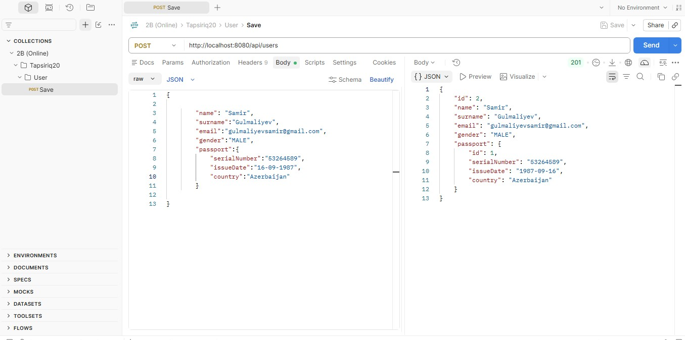
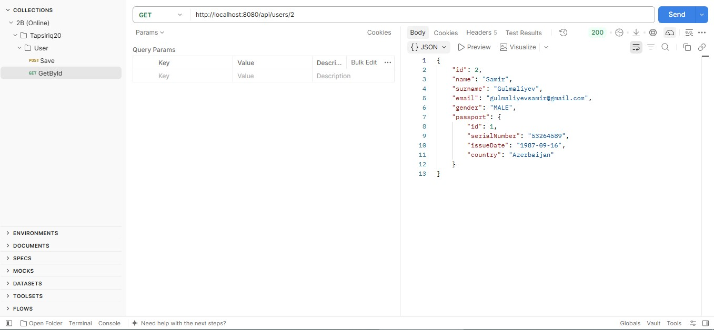
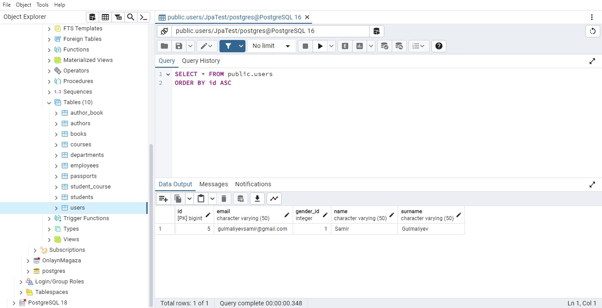
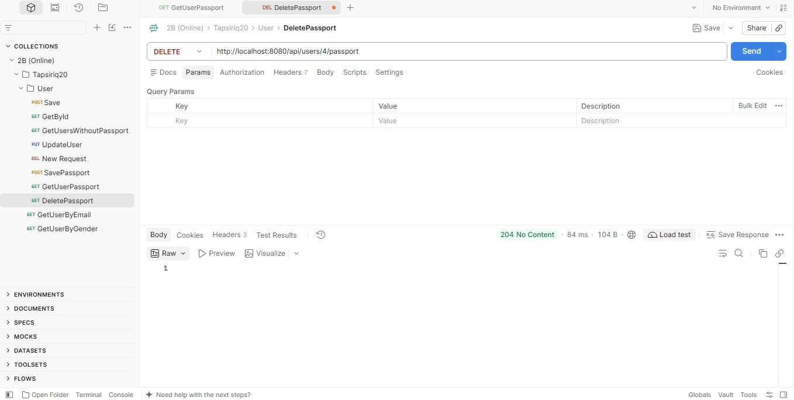
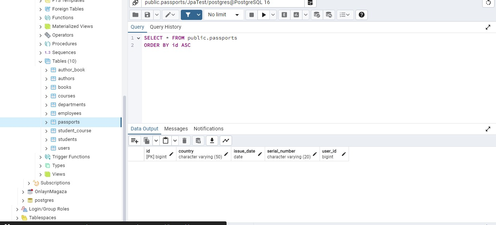

## 10. User yaradın, passport əlavə edin, GET /api/users/{id} ilə passportun gəldiyini göstərin.

## 11. Bazada users.gender_id sütununda 1/2 yazıldığını pgAdmin/DBeaver ilə göstərin.

## 12. Passportu silin – passports cədvəlində sətrin silindiyini göstərin (orphanRemoval).

